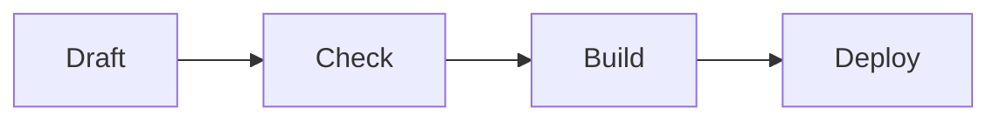

# 架構與內容規劃

← [規劃入口](README.md)｜[部署](deployment.md)｜[里程碑](milestones.md)

## 1. 技術棧：Astro + TypeScript，輸出純靜態檔

採 Astro、TypeScript、npm lockfile 與 Node.js 24 LTS。實作開始時固定 Astro 與直接依賴的確切版本，CI 一律使用 `npm ci`。不先加入 React、Vue、Tailwind 或 CMS。

「全靜態」是不可退讓的 contract：不安裝 server adapter，不允許任何頁面宣告 `export const prerender = false`；所有動態 route 都用 `getStaticPaths()` 在 build-time 列舉完成。`dist/` 不得出現 server entry、server manifest 或 adapter runtime。

理由：

- Astro 原生處理 Markdown；Content Collections 可驗證 frontmatter 並產生靜態 route。
- `.astro` component、vanilla CSS 與 design tokens 足以支撐多次視覺改版。
- MVP 可輸出零 client-side JavaScript，GitHub Pages 只需託管 build artifact。
- build 工具與閱覽成品完全分離：`node_modules` 只在開發機／GitHub Actions，不會提供給訪客。

替代方案：

| 選項 | 優點 | 未採用原因 |
|---|---|---|
| Jekyll | Pages 歷史整合成熟 | Ruby/Liquid 與 plugin 限制對元件化改版較不順手 |
| Hugo | 單一 binary、build 快 | Go templates 與內容 schema 不符合本專案偏好 |
| Eleventy | 小而自由 | schema、圖片與元件約束需自行拼裝較多 |
| VitePress | Markdown 體驗完整 | 資訊架構偏文件站 |
| Next static export | 生態大 | 對純靜態 Markdown blog 過重 |

## 2. 文章與 frontmatter contract

每篇文章是一個只含 Markdown 的資料夾：

```text
src/content/posts/2026/hello-world/
  index.md
```

資料夾裡只有 `index.md`。圖片集中放在頂層 `media/<slug>/`，文章只寫一條站內連結，理由與規則見 [§4](#4-圖片)。

`posts` 使用 build-time collection：

```text
glob({
  pattern: "**/index.md",
  base: "./src/content/posts",
  deferRender: true,
})
```

實作固定支援 `deferRender` 的 Astro 確切版本。production 先取得公開文章集合，只對該集合呼叫 `render()`；draft 仍驗證 frontmatter，但不先執行 Markdown／Mermaid renderer，也不產生 draft asset。本機明確預覽某篇 draft 時才 render 它。

公開路徑由 frontmatter 的 `slug` 決定，年份資料夾只整理 source；移動 source 不改公開 URL。

每篇文章最小 frontmatter：

```yaml
---
title: 第一篇文章
slug: hello-world
description: 一句可用於列表、RSS 與 SEO 的摘要
publishedAt: "2026-08-17"
updatedAt: "2026-08-18" # 可省略
draft: true
tags:
  - astro
---
```

沒有 `cover` 欄位。列表與 OG 都不使用縮圖，理由見 [§4](#4-圖片)。

schema 與內容規則：

- `title`、`slug`、`description`、`publishedAt`、`draft`、`tags` 必填；`tags` 至少一個且去重。
- `publishedAt`／`updatedAt` 必須是加引號的 `YYYY-MM-DD` date-only string。先驗證格式，再以實際曆法檢查年月日往返相等；`2026-02-30` 之類不可被自動正規化成另一日。
- 合法 ISO date-only string 是排序與 archive key 的權威來源；月份直接取驗證後的 `YYYY-MM`，顯示採 `zh-Hant`、`Asia/Taipei`。禁止依 CI runner 本地時區或裸用 `Date#getMonth()` 分組。
- `updatedAt` 可省略，但不可早於 `publishedAt`。
- `slug` 符合 `^[a-z0-9]+(?:-[a-z0-9]+)*$` 且全站唯一；改 slug 等同破壞既有 URL，須另做 redirect 決策。
- `draft: true` 在 production 的 render、route、列表、RSS、sitemap 與 asset 中完全排除，本機可按需預覽。
- 正式內容拒絕 raw HTML、`<script>`、event-handler attribute 與 remote hotlink。圖片一律引用本 repo 的 `/images/...`（[§4](#4-圖片)）。

## 3. 一般 blog 導航

所有導航均於 build-time 產生，不用前端篩選器：

- 首頁顯示最新文章，依 `publishedAt` 新到舊排序。
- `/posts/` 是完整文章列表；達到 20 篇後才啟用靜態分頁，避免先做空殼。
- `/archive/` 依年份／月份分組，列出每月文章數與文章清單。
- `/archive/<YYYY>/<MM>/` 是該發布月份的獨立靜態列表頁；月份固定兩位數。
- 文章頁明確顯示發布日期、可選更新日期與所有 tags；發布日期可點到對應月份頁。
- `/tags/` 列出全部標籤、文章數與最近更新日期。
- 點文章 tag 進 `/tags/<tag-slug>/`，看到該標籤的文章列表。
- 每個 tag page 都是獨立靜態 HTML，可分享、可索引、重新整理不失效。
- 文章頁提供上一篇／下一篇；RSS 只收 production 已發布文章。

`getPublishedPosts()` 是公開內容的唯一投影來源：集中完成 draft filter、`publishedAt` 新到舊排序、同日以 `slug` 升冪作 deterministic tie-break，以及唯一性檢查。首頁、文章列表、上一篇／下一篇、RSS、sitemap 及下列三組 `getStaticPaths()` 都只能使用它：

- article paths：每篇輸出 decoded `params.slug = data.slug`。
- tag paths：對文章 tags 做正規化、去重後輸出 decoded `params.tag`。
- month paths：從合法 date-only string 去重出 `{ year, month }`，兩者均為字串且月份兩位數。

驗收時要把 `getStaticPaths()` 的回傳集合與獨立產生的公開 route inventory 逐項比較，不能只抽查某一頁。

tag 顯示文字保留原字；route slug 先做 Unicode NFC、去除首尾空白、Latin 小寫化並把空白序列轉成單一 `-`，結果只接受 Unicode letter／number 與單一 hyphen 分隔，JavaScript validator 明確使用 `/^[\p{L}\p{N}]+(?:-[\p{L}\p{N}]+)*$/u`。傳給 `getStaticPaths()` 的是 decoded segment，由 Astro 處理 URL encoding；不得自行 percent-encode。空值、控制字元，以及 `#`、`?`、反斜線、`:`、`%`、`/`、`.`、保留字或正規化碰撞都讓 build 失敗。

## 4. 圖片

本站沒有任何裝飾性、角色或美術圖像。`miku-cyber` 只是配色風格，不是素材主題。圖片只為一種用途存在：**技術截圖**——終端機輸出、設定畫面、實際渲染結果這類無法用文字或流程圖表達的內容。

- 沒有 cover／縮圖。列表、首頁與文章頁都是純文字排版，不預留圖位。
- 沒有站級 Open Graph 圖。OG 只輸出 `og:title`、`og:description`、`og:url`、`og:type`、`og:locale`，不輸出 `og:image`；沒有圖比放一張湊數的圖好。
- 只有實際需要的文章才有圖，多數文章一張都沒有。

### 圖片與文章分開放，但都在本 repo

圖片不放在文章資料夾裡，而是集中在頂層的 `media/<slug>/`；文章只寫一個站內連結：

```markdown

```

作者看到的就是一條乾淨的連結，圖片管理與寫作分離。同時它仍在本 repo 內，所以：build 不需要連網、來源不會掛掉、圖片與文章是同一個 commit、授權由根 `LICENSE` 一併涵蓋。

為什麼不放到外部 repo：那能省下 git 歷史的長期膨脹，但代價是 build 依賴外部可用性、部署多一個要維護的 repo、授權邊界也要另外聲明。以本站的量級（多數文章零張圖）不值得——repo 大小不會是瓶頸。

### 為什麼不是 `public/images/`

這是最直覺的位置，但它與 draft 規則直接衝突：`public/` 是**原樣複製**進 `dist/`，所以 draft 文章的截圖會跟著部署出去，違反「production `dist/` 找不到 draft 的任何 asset」。

也不用 `src/assets/`：它能拿到 Astro 的 responsive variants，但從 `src/content/posts/<year>/<slug>/index.md` 引用要寫成 `../../../../assets/...`，與「只留一條乾淨連結」衝突。

因此 `media/` 是**來源目錄，不是輸出目錄**。build step 只把公開文章實際引用到的檔案複製到 `dist/images/<slug>/`：

- draft 的圖片天然不會進 artifact，不需要額外的排除清單。
- 沒有任何文章引用的孤兒檔案也不會被部署，並由 verify 回報。
- `media/` 本身永遠不出現在 `dist/`。

### 路徑與 base

`/images/...` 是 logical root URL，由 [deployment.md](deployment.md#2-url-contract) 既有的 Markdown transformer 加上恰好一次 `BASE_URL`，不需要新機制。作者不得自行寫 `/self_blog/images/...`。

`media/<slug>/x.webp` 與 `/images/<slug>/x.webp` 的對應是固定的一對一映射，不做別名或改寫。

### rehype plugin 補回的東西

因為不過 Astro 的圖片管線，下列由 plugin 處理。檔案就在本地，全是確定性操作：

- 讀出實際尺寸，替 `` 注入 width/height（保住 CLS）。
- below-the-fold 自動加 `loading="lazy"` 與 `decoding="async"`。
- 檔案不存在、超過大小或尺寸上限、alt 為空，都讓 build 失敗。

失去的只有多尺寸 `srcset`。對截圖而言，一張尺寸合宜的 WebP 已經足夠；真的需要 srcset 時再另立 ADR。輸出檔名不帶 content hash，所以不宣告 immutable caching——對更新頻率極低的截圖無所謂，但換圖時要換檔名。

### 共通規則

- 圖片必須有有意義的 alt。本站不存在純裝飾圖，所以**空 alt 一律視為錯誤**：截圖沒有東西好描述就代表它不該存在。
- 單張圖片檔 ≤ 200 KiB、最長邊 ≤ 1600px，作者存檔時就壓好（WebP 優先）。因為不過最佳化管線，`media/` 的來源檔就是讀者下載的檔案，gate 必須設在入口。
- 只接受本 repo 內的 `/images/...`；不 hotlink 任何遠端圖片，以免失效、追蹤與授權不明。
- favicon 等站級小檔直接放 `public/` 根。`public/` 底下沒有 `images/`。

## 5. Mermaid：build-time static SVG

作者仍只寫標準 Markdown fence：

````markdown

````

處理方式：

- 以 Astro Markdown 管線（unified）的 remark/rehype plugin 辨識 Mermaid fence，於 `astro.config` 的 `markdown.remarkPlugins`／`rehypePlugins` 註冊。Astro 沒有其他官方 Mermaid hook。
- `markdown.syntaxHighlight.excludeLangs` 包含 `mermaid`，避免先被一般 highlighter 改寫。該選項有最低 Astro 版本需求，M0 固定版本時一併確認。
- build step 以 `securityLevel: "strict"` 產生 content-hashed、尺寸已知的 SVG asset。
- cache key 包含 diagram source、Mermaid 版本與 theme diagram tokens。
- 語法錯誤或缺 `accTitle`/`accDescr` 直接讓 production build 失敗。
- HTML 只引用完成的 SVG；沒有 Mermaid runtime、初始化 script 或 CDN request。

實際 renderer 由 M0 依 license profile 選定。即使 build-only 工具很大，它也只能存在 CI，不能進 Pages artifact。

## 6. 可替換主題

樣式分三層：

1. primitives：色階、間距、字級、圓角、陰影、動畫時長。
2. semantic tokens：背景、表面、正文、次要文字、連結、邊框、焦點等角色。
3. component/prose styles：顏色只能用 semantic tokens，尺寸可用共享 primitives。

首批 theme pack：

- `miku-cyber`：預設；深海軍藍、青藍／薄荷綠、低強度網格與光暈。
- `plain`：無裝飾、高可讀性的對照主題，用來抓出元件偷綁主題色的問題。

最小 token contract：

```text
--color-bg            --color-surface       --color-text
--color-muted         --color-accent        --color-link
--color-border        --color-code-bg       --focus-ring
--font-body           --font-mono            --measure-prose
--space-*             --radius-*             --shadow-*
--motion-fast         --motion-slow
```

主題在 build-time 選定，不放進文章 frontmatter，也不做 runtime theme switch。換 theme 時 Mermaid 一併用對應 tokens 重建。`miku-cyber` 是**配色風格的名字，不是素材主題**：它只由 token 值構成，全站不出現角色圖像、官方 logo、周邊素材或外部字型。首版只有 system fonts 與自製 CSS/SVG。

### 配色偏好

build-time theme 決定的是「哪一套 token pack」，不是「深色或淺色」。每個 theme pack 都必須同時定義 light 與 dark 兩組 semantic token 值，並以 `@media (prefers-color-scheme: dark)` 切換：

- `miku-cyber` 的 dark 是主要造型；light 是同色系的高亮度變體，兩者都要獨立通過 WCAG AA。
- 這是純 CSS media query，不違反 0-JS。真正需要 JavaScript 的是「讀者可操作的切換器」，MVP 不做。
- `<meta name="color-scheme" content="light dark">` 讓捲軸與表單控制項跟著配色走。
- token 只能定義在 `:root` 與 dark media block 兩處；component 內不得再出現任何 media query 覆寫顏色。

### 中文排版

本站以繁體中文為主要語言，排版指標不沿用拉丁文預設：

- `<html lang="zh-Hant">`；RSS channel 宣告 `<language>zh-Hant</language>`；Open Graph 使用 `og:locale = zh_TW`。
- `--measure-prose` 的目標是**每行 35–45 個全形字**，不是 65–75 個拉丁字元。`ch` 以 `0` 的寬度為準，套在 CJK 上會失真，因此用 `em` 或 `rem` 表達，並以真實中文 fixture 目視確認。
- 字型堆疊明確列出繁中 system font fallback（`-apple-system`／`"PingFang TC"`／`"Microsoft JhengHei"`／`"Noto Sans TC"`／`sans-serif`），不下載任何 web font；中英混排時 Latin 字型排在中文字型之前。
- 中文段落 `line-height` 不低於 1.75。`overflow-wrap: anywhere` 只施加於 code 與長 URL；正文交給瀏覽器預設的 CJK 斷行，不使用 `word-break: break-all`。

可讀性要求：預設字級至少 16px、長 code block 可水平捲動、鍵盤焦點清楚、一般文字達 WCAG AA，並尊重 `prefers-reduced-motion`。

## 7. 訪客下載 hard budget

量測 production output 使用三個固定 fixture：典型首頁、一篇約 2,000 字的純文字文章，以及一篇約 2,000 字且含 code、一張截圖與一張流程圖的「重量級」文章。因為沒有 cover 與裝飾圖，首頁與多數文章根本不會發出圖片 request。

| 項目 | 量測 fixture | MVP hard budget |
|---|---|---|
| client JavaScript | 全部頁面 | 0 bytes、0 request |
| 全站共用 CSS | 全部頁面 | gzip 後 ≤ 24 KiB |
| 390px 首頁首屏 | 首頁 | HTML + CSS + favicon ≤ 120 KiB、≤ 8 requests、0 圖片 request |
| 純文字文章首載 | 純文字文章 | HTML + CSS + favicon ≤ 100 KiB |
| 文章頁 total transfer | 重量級文章 | 全部資源合計 ≤ 400 KiB、≤ 12 requests |
| 單一 Mermaid SVG | 任何頁面 | ≤ 100 KiB |
| 單張圖片檔 | 任何頁面 | ≤ 200 KiB、最長邊 ≤ 1600px |
| 第三方 origin request | 全部頁面 | 0 request |

`total transfer` 這一列是防止逐項上限被組合繞過：單張圖 200 KiB、單張 SVG 100 KiB 各自合規，疊幾份仍可讓一頁破 1 MB。任一列失敗即整體失敗，不同列之間不可互相抵銷。

因為圖片放在 `public/`、不過最佳化管線（[§4](#4-圖片)），「單張圖片檔」這一列同時是入口 gate 與輸出 gate——來源檔就是讀者下載的檔案，兩者不會分歧。

不用 web font、CDN runtime、analytics、client router、prefetch framework 或 hydration。`dist/` 若出現 `node_modules`、套件 source、`.map`、Markdown source、workflow/docs 或未使用 asset，驗證直接失敗。未來任何 client JS 都要另立 Accepted ADR，說明必要性、逐頁範圍與 byte budget。

## 8. 預定程式結構

```text
media/
  <slug>/*.webp          # 來源目錄；只有被公開文章引用的檔案會進 dist/images/
public/
  favicon.svg
scripts/
  verify-built-site.mjs
  verify-content.mjs
  verify-performance.mjs
  verify-workflow-snapshot.mjs
  smoke-site.mjs
src/
  config/site.ts
  content.config.ts
  content/posts/<year>/<slug>/index.md
  lib/{posts, route-inventory, tags}.ts
  components/{Head, SiteHeader, SiteFooter, PostCard}.astro
  layouts/{BaseLayout, PostLayout}.astro
  pages/index.astro
  pages/archive/index.astro
  pages/archive/[year]/[month].astro
  pages/404.astro
  pages/posts/index.astro
  pages/posts/[slug].astro
  pages/tags/index.astro
  pages/tags/[tag].astro
  pages/rss.xml.ts
  pages/licenses.astro
  styles/{reset, base, prose, syntax}.css
  themes/contract.css
  themes/miku-cyber/theme.css
  themes/plain/theme.css
  themes/registry.ts
```

### npm script 對照

`npm run verify` 是唯一品質入口，其組成必須在文件裡可查，不能只靠讀 `package.json` 推測：

| npm script | 執行內容 | 涵蓋 | 併入 `verify` |
|---|---|---|---|
| `verify:workflows` | `scripts/verify-workflow-snapshot.mjs` | manifest、notice hash、相對連結、forbidden-term scan | M1 起 |
| `verify:content` | `astro check` + `scripts/verify-content.mjs` | frontmatter schema、slug/tag/date 規則、internal link | M3 起 |
| `verify:build` | `astro build` | production 靜態輸出 | M2 起 |
| `verify:dist` | `scripts/verify-built-site.mjs` | artifact hard gate，見 [deployment.md](deployment.md#5-artifact-hard-gate) | M2 起 |
| `test:preview` | `scripts/smoke-site.mjs` | 把 `dist/` 掛在 base 下走完 route inventory | M2 起 |
| `test:content` | `scripts/verify-content.mjs --fixtures` | 正／負 fixture | M3 起 |
| `verify:performance` | `scripts/verify-performance.mjs` | byte/request hard budget | M5 起 |

`npm run verify` 依序執行上表所有已啟用項目，第一個失敗即停止。PR run 與 main run 執行的是同一個 `verify`，差別只在其後的 upload/deploy step。任何 milestone 新增檢查時，必須在同一個 commit 把它接進 `verify`；沒有接進去的檢查不算存在。

## 9. MVP 與非目標

MVP：首頁、文章列表／靜態分頁、archive index、per-month page、文章頁、tag index、per-tag page、404、GFM、heading anchors、build-time code highlighting、技術截圖、Mermaid SVG、RSS、sitemap、canonical 與基本 Open Graph（不含 `og:image`）。

暫不包含：CMS、留言、全文搜尋、analytics、多作者、國際化、文章級主題、讀者帳號、SSR、runtime theme switch。它們有實際需求時另寫 ADR。

## 參考

- [Astro Content Collections](https://docs.astro.build/en/guides/content-collections/)
- [Astro Content Loader API](https://docs.astro.build/en/reference/content-loader-reference/)
- [Astro Markdown 與 remark/rehype plugin](https://docs.astro.build/en/guides/markdown-content/)
- [Astro images](https://docs.astro.build/en/guides/images/)
- [Mermaid accessibility](https://mermaid.js.org/config/accessibility.html)
- [WCAG 2.2](https://www.w3.org/TR/WCAG22/)
